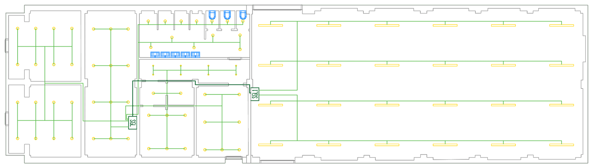
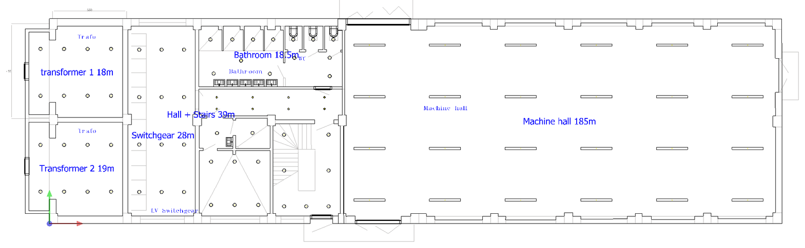
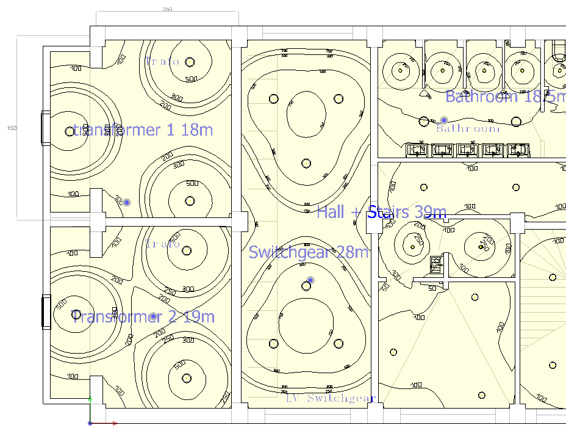
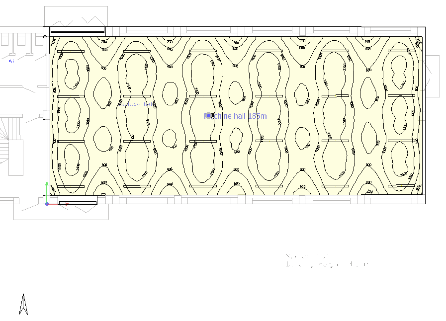
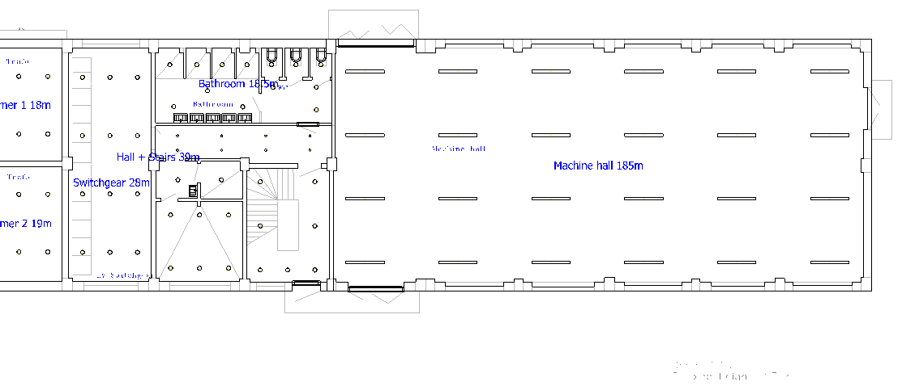
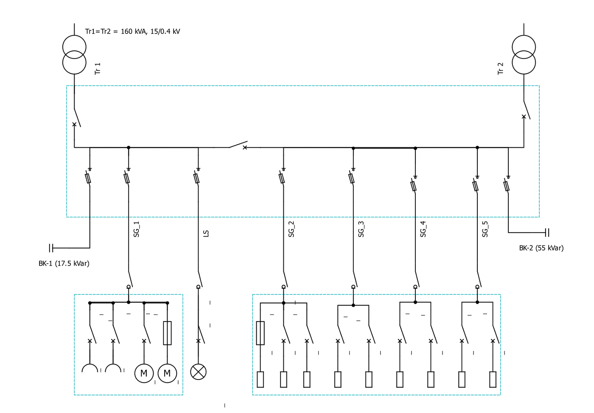
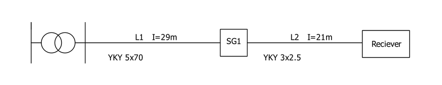

# Industrial Building Electrical Installation: Lighting to MV/LV Substation

Complete electrical design for an industrial facility, from the lighting in each room up to the transformer substation that feeds the building. It covers DIALux evo lighting design, circuit and protection sizing, reactive power compensation, transformer selection and a full protection audit (automatic disconnection, thermal stability, selectivity).

Solo semester-long project for the **Electrical Networks and Installations** course at Warsaw University of Technology (2025/26).



## At a glance

| | |
|---|---|
| Facility | Industrial building: switchgear room, 2 transformer rooms, bathroom, hall and stairs, plus a 185 m² machine hall |
| Lighting | Modelled in DIALux evo; every room meets its illuminance and uniformity targets, with the machine hall at ≈ 1000 lx against a 750 lx requirement |
| Lighting circuits | 6 circuits, worst-case voltage drop 1.3% (limit 3%), MCB B10/C10 plus a 30 mA RCBO for the bathroom |
| Power factor | Two capacitor banks (17.5 kvar and 55 kvar) bring tan φ down to the required 0.368 |
| Substation | 2 × 160 kVA, 15/0.4 kV transformers in hidden reserve: either one can carry the whole plant |
| Protection | Automatic disconnection, thermal stability and selectivity checked on the worst-case paths |

---

## Part 1: Lighting installation

### The facility



- **Site 1:** switchgear room, two transformer rooms, bathroom, and a hall with stairs. Lit from a dedicated lighting switchgear (SGL).
- **Site 2:** the 185 m² machine hall, fed from its own lighting switchgear (SGL1) off the main switchgear.

| Room | Required average illuminance |
|---|---|
| Machine hall | 750 lx |
| Transformer rooms 1 & 2, switchgear room | 200 lx |
| Bathroom, hall & stairs | 100 lx |

### Two models: realistic vs calculation

I built the building twice in DIALux evo:

1. **Realistic model**, with bathroom stalls, door openings, stair linings and sinks. Great for visualizing the space, but all that geometry breaks up the calculation surfaces.
2. **Simplified calculation model**, with the non-flat obstructions removed, to check whether the luminous flux distribution itself is right.

The realistic geometry made the uniformity target (U₀) impossible to hit in the cluttered rooms, even though the average illuminance passed everywhere. On my instructor's guidance, compliance was assessed on the calculation model, and the final realistic model uses the same luminaire layout.

| Room | Realistic model: Ē / U₀ | Calculation model: Ē / U₀ | Targets |
|---|---|---|---|
| Transformer room 1 | 210 lx / 0.47 | 213 lx / 0.47 ✅ | ≥ 200 lx / ≥ 0.40 |
| Transformer room 2 | 205 lx / 0.38 | 209 lx / 0.46 ✅ | ≥ 200 lx / ≥ 0.40 |
| Switchgear room | 215 lx / 0.47 | 214 lx / 0.47 ✅ | ≥ 200 lx / ≥ 0.40 |
| Bathroom | 224 lx / 0.20 | 288 lx / 0.43 ✅ | ≥ 100 lx / ≥ 0.40 |
| Hall & stairs | 238 lx / 0.10 | 260 lx / 0.59 ✅ | ≥ 100 lx / ≥ 0.40 |
| **Machine hall** | 975 lx / 0.43 | **997 lx / 0.72** ✅ | ≥ 750 lx / ≥ 0.70 |

| Auxiliary rooms (illuminance contours) | Machine hall (calculation model) |
|---|---|
|  |  |



### Luminaires

| Where | Luminaire | Specs |
|---|---|---|
| Machine hall (24×) | VARTON industrial LED linear, V1-IA-70155-03A12 | 80 W, 10 300 lm, 129 lm/W, 5000 K |
| Transformer rooms, switchgear room, bathroom | ENDO fixed downlight ERD7516W | 7.7 W, 925 lm, 120 lm/W, 4000 K |
| Hall accents | ENDO adjustable downlight ERD8639W | 5.9 W, 590 lm, 100 lm/W, 4000 K |

### Circuits and protection

Design current `I_B = P / (U_n · cos φ)` at 230 V, with cos φ taken as 0.9 for the machine hall and 0.85 elsewhere for margin. Voltage drop for single-phase circuits:

```
ΔU% = 200 · P · L / (γ · S · Un²)       γ = 56 m/(Ω·mm²), S = 1.5 mm², L = 30 m (worst case)
```

| Circuit | Fixtures | P [W] | I_B [A] | ΔU% | Protection | Cable |
|---|---|---|---|---|---|---|
| Machine hall, circuit 1 | 12 × VARTON 80 W | 960 | 4.64 | 1.30 | MCB C10 | YDY 3×1.5 |
| Machine hall, circuit 2 | 12 × VARTON 80 W | 960 | 4.64 | 1.30 | MCB C10 | YDY 3×1.5 |
| Transformer rooms 1 & 2 | 16 × ENDO 7.7 W | 123.2 | 0.63 | 0.17 | MCB B10 | YDY 3×1.5 |
| Switchgear room | 12 × ENDO 7.7 W | 92.4 | 0.47 | 0.12 | MCB B10 | YDY 3×1.5 |
| Hall & stairs | 15 × ENDO + 8 × adjustable | 162.7 | 0.83 | 0.22 | MCB B10 | YDY 3×1.5 |
| Bathroom | 13 × ENDO 7.7 W | 100.1 | 0.51 | 0.14 | RCBO B10, 30 mA | YDY 3×1.5 |

Design choices:

- **C-curve breakers for the machine hall**, to ride through the inrush of the 80 W LED drivers; B-curve everywhere else
- **No more than 20 fixtures per circuit**, so the machine hall is split into two circuits
- **30 mA RCBO** on the bathroom circuit for residual current protection in a wet area
- **No wall switches in the machine hall.** Control is centralized at the switchgear so lights can't be switched off by accident while machines are running.

---

## Part 2: MV/LV substation and protection analysis



### 1. Load balancing between the two busbar sections

| Section | Switchgears | P [kW] | Q [kvar] |
|---|---|---|---|
| 1 | SG1, lighting switchgear | 56.20 | 34.76 |
| 2 | SG2 to SG5 | 62.55 | 73.14 |
| **Total** | | **118.75** | **107.90** |

SG1 is the single largest load, so it sets the split. A 6.3 kW difference is the most even split the discrete loads allow.

### 2. Reactive power compensation (target tan φ ≤ 0.368)

`Q_k = P · (tan φ_natural − tan φ_required)`

| Section | Required | Selected bank | Fuse | Cable |
|---|---|---|---|---|
| 1 | 14.05 kvar | BK-S-17.5 (17.5 kvar) | gG 40 A | YKXS 4×10 |
| 2 | 50.07 kvar | BK-S-55/5 (55 kvar) | gG 125 A | YKXS 4×35 |

Capacitor banks draw inrush current and amplify harmonics, so the bank current is multiplied by a safety factor of 1.4 before the fuse is sized. Each cable is then checked against the standard coordination conditions (`I_B ≤ I_n ≤ I_z`, `I_2 ≤ 1.45 · I_z`, with temperature correction).

### 3. Transformer selection: hidden reserve

Either transformer must carry the **entire** plant if the other fails. After compensation (107.9 − 72.5 = 35.4 kvar net):

```
S ≥ √(118.75² + 35.4²) = 123.9 kVA   →   2 × 160 kVA, 15/0.4 kV
```

From the catalogue data (ΔP_Cu = 2.35 kW, u_k = 4%): **R_T = 14.7 mΩ, X_T = 37.2 mΩ, Z_T = 40 mΩ**, which feed into the fault calculations.

### 4. Protection against electric shock (automatic disconnection)

The fault loop impedance runs from the transformer through the distribution line to the furthest point. The requirement is `I_k = U₀ / Z_s ≥ I_a`, with disconnection within 0.4 s for final circuits and 5 s for distribution circuits.



| Point checked | Z_s | Fault current I_k | Device needs | Result |
|---|---|---|---|---|
| End of MS → SG1 (YKY 5×70, 29 m) | 45.2 mΩ | 5089 A | 100 A fuse clears in < 0.01 s | ✅ |
| Furthest socket (YKY 3×2.5, 21 m) | 0.177 Ω | 1299 A | C16: 160 A | ✅ |
| Lighting final circuit (YKY 3×1.5) | 0.405 Ω | 568 A | B10: 50 A | ✅ |
| SG5 feeder (YKY 5×2.5, 28 m) | 0.218 Ω | 1055 A | gG 25 A: ≈ 700 A | ✅ |

### 5. Thermal stability of conductors

`t_permissible = (k · S / I_k)²` with k = 115, plus the Joule integral `(k·S)² ≥ I²t` when disconnection is faster than 0.1 s.

| Conductor | t_permissible | Turn-off time | Joule check |
|---|---|---|---|
| MS → SG1, 70 mm² | 2.50 s | ≤ 0.01 s | ✅ |
| Socket circuit, 2.5 mm² | 0.049 s | ≤ 0.01 s | 82 656 ≥ 20 000 A²s ✅ |

### 6. Selectivity

- **Fuse–fuse:** 100 A upstream over 63 A downstream gives a ratio of 1.59, right at the 1.6 limit, so selectivity is partial
- **Fuse–MCB:** 100 A fuse over the C16 socket breaker stays selective at the 1.3 kA available fault current

---

## What I would do differently now

I learned a lot during this project, and with what I know now I would:

- **Hit uniformity in the realistic model itself**, using more, lower-output luminaires around obstructions, instead of relying on the simplified model
- **Use the measured length of each circuit** for voltage drop, instead of one 30 m worst case for all of them
- **Make the fault-loop calculation more conservative** by including the protective conductor's return path, and confirm selectivity by overlaying the manufacturers' time-current curves instead of using rule-of-thumb ratios

## Repository contents

```
docs/project2_lighting_installation.pdf       Lighting design and circuits report
docs/project3_substation_and_protection.pdf   Substation, compensation and protection report
dialux/simplified_calculation_model.evo       DIALux evo calculation model
dialux/final_realistic_model.evo              DIALux evo realistic model with the final layout
images/                                       Plans, DIALux results and diagrams
```

**Open the models** in DIALux evo, a free download from dialux.com. They were saved with a 2025 release, so use a current version.

## Tools

DIALux evo, AutoCAD (floor plans, wiring layout and cable lengths), LaTeX for the reports.
